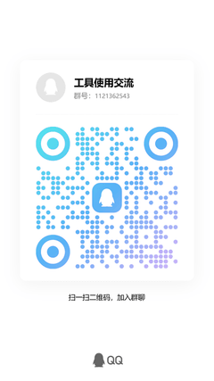

# open-design — OpenDesign 技能库（按业务领域分包）

把 [OpenDesign](https://github.com/nexu-io/open-design) 的完整技能库接进 DeepSeek Harness，按**业务领域**切成九个技能包，再配一个能调度本机所有 Agent 的设计总监。

| 类别 | 数量 | 内容 |
| --- | --- | --- |
| 工艺技能 | 85 | 界面设计、动效、视频、演示、社媒、写作、品牌、前端、质检 |
| 设计系统契约 | 152 | 每套一套完整视觉令牌（Apple、Stripe、Linear、Swiss、Brutalist…） |

## 安装

```sh
dsh plugin --profile web add open-design
```

重启 DSH 后，九个领域的技能索引会出现在技能目录里，并生成 `od-director`（设计总监）这个 Agent。

## 九个领域

| id | 名称 | 技能 | 默认 |
| --- | --- | --- | --- |
| `od-visual-design` | 视觉设计 | 12 + 152 套设计系统 | ✅ |
| `od-motion` | 动效设计 | 13 | ✅ |
| `od-video` | 视频制作 | 17 | ✅ |
| `od-presentation` | 演示汇报 | 10 | ✅ |
| `od-social-content` | 社媒图文 | 7 | ✅ |
| `od-writing` | 内容写作 | 8 | ✅ |
| `od-brand` | 品牌资产 | 8 | ✅ |
| `od-frontend` | 前端实现 | 6 | ✅ |
| `od-review` | 质检审核 | 4 | ✅ |

**九个领域默认全开。** 一个领域在技能目录里只占一行 `name: description`，正文是你或子 Agent 按需加载时才读的；而关掉的领域对设计总监等于不存在，它没法知道自己缺了什么。每个技能只属于一个领域，九包合起来恰好覆盖全部 85 个工艺技能。

## 开关领域

### 方式一：设置页面（推荐）

安装并重启后，打开 **设置 → OpenDesign 领域**：

- 九个领域逐个开关，每个都能展开看它包含哪些技能；
- 改动会**当场写入配置并同步磁盘**，关闭的领域技能目录立即移除；
- 页面底部列出当前的 Agent 预设，并提供「重新生成 Agent」。

> 技能列表与 Agent 选择器在**新建会话**后刷新——这是宿主技能目录的刷新时机，不是插件的问题。

### 方式二：命令行

```sh
odx domains list                 # 看九个领域与开关状态
odx domains enable od-video      # 开启（可一次给多个 id）
odx domains disable od-motion    # 关闭
odx domains enable-all           # 全开
odx domains disable-all          # 全关
odx agents list                  # 看已生成的 Agent
odx sync                         # 按当前配置重新同步
```

没装成全局命令时，直接调脚本：

```powershell
node "$env:USERPROFILE\.dsh\profiles\desktop\node_modules\open-design\bin\odx" domains list
```

### 方式三：编辑配置文件

`$DSH_HOME/open-design/domains.json`：

```json
{
  "version": 1,
  "enabled": ["od-visual-design", "od-motion", "od-video", "od-presentation", "od-social-content", "od-writing", "od-brand", "od-frontend", "od-review"]
}
```

文件损坏会自动回退到「全部开启」并留一份 `.bak`；写了不认识的领域 id 会被忽略并提示。

## Agent：只有一个设计总监

插件只生成**一个** Agent：**`od-director`（设计总监）**。

| Agent | 作用 |
| --- | --- |
| `od-director` | 承接复合任务，拆解后派给本机已安装的合适 Agent，验收汇总；小活自己做 |

九个领域 Agent 已经删掉。它们不带 `delegation`，跨领域的活无法转交，只能自己做或干等——每一层都丢一次上下文。领域现在只提供**技能**：总监自己按需加载，或把某个技能指给子 Agent。

### 花名册：所有预设互相可见

总监的 `subagent` 工具的 `agent_preset` 参数只接受 `allowedAgentPresets` 白名单里的 id，这是宿主的静态约束，没有运行时枚举接口。所以「谁可以被委派」必须在同步时写进白名单：

1. `sync` 扫描 `$DSH_HOME/agent-manager/presets/*/agent.json`，读出每个预设的 `id / name / summary`；
2. 挂载时再从宿主 `agentPresets.list()` 读一遍，补上内置预设（`standard`、`ptc` 等没有磁盘 spec 的那些）；
3. 合并去重后写进总监的 `team` —— 也就是 `allowedAgentPresets`；
4. 同一份花名册连同每个人的「能做 / 不能做」写进总监的提示词，它才有依据挑人，而不是按名字猜。

所以：

- **Agent 管理里自建的 Agent** 装好后，重新生成一次总监就会进花名册；
- **内置预设** 随宿主注册表自动进入；
- 哪个都不需要手工登记。关闭某个领域**不再**影响花名册——领域是技能，不是人。

总监的提示词里明确写了：要委派就从花名册挑现成的；没有合适的就自己做，**不要临时创建一个 Agent**；同一个子 Agent 做过这件活，用 `send_message` 让它接着改，不要为每轮修改重派新人。

### ⚠️ Agent Teams 不支持

`dsh-agent-teams` 的 `spawn_teammate` **不支持 `agentPreset` 参数**，团队成员继承 Lead 的配置。所以**不要**用 `agent_teams_add_member` 挂这些 Agent。

要用子 Agent，走 `subagent` 的 `agent_preset`。

## 目录结构

```
plugins/open-design/
├── index.js              # 插件入口：挂载时同步、注册 Agent、挂载设置路由
├── client.js             # 设置页面（设置 → OpenDesign 领域）
├── domains.mjs           # 九个领域定义与技能归属（唯一数据源）
├── skills.mjs            # 技能发现 + 单领域 SKILL.md 渲染
├── config.mjs            # domains.json 读写与容错
├── agents.mjs            # 设计总监的规格生成 + 花名册扫描
├── sync.mjs              # 磁盘事务：写技能目录、写总监、清理旧领域 Agent
├── state.mjs             # 设置页的数据层（describe / applyToggle / regenerateAgents）
├── routes.mjs            # 设置页的 HTTP 接口（GET/PATCH/POST /open-design/*）
├── cli.mjs + bin/odx     # odx 命令
├── lifecycle.test.mjs    # 测试
├── cordis.patch.yml
└── vendor/open-design/   # 上游原样副本，勿改
    ├── skills/                       # 85 个工艺技能
    └── design-system-skills/         # 152 个设计系统契约
```

生成到磁盘的内容：

```
$DSH_HOME/skills/od-<领域>/SKILL.md          每个启用领域一个索引页
$DSH_HOME/agent-manager/presets/od-director/ 唯一生成的 Agent（设计总监）
$DSH_HOME/open-design/domains.json           开关配置
```

## 二次开发

`vendor/open-design/` 保持上游原样，方便区分「上游内容」与「我们改的东西」。要改行为，改 `domains.mjs`（领域归属）或 `agents.mjs`（Agent 提示词）。

改完自检：

```sh
node plugins/open-design/lifecycle.test.mjs plugins/open-design
```

或在仓库根目录跑 `pnpm run test:open-design`。

测试覆盖：领域表分区（85 个技能恰一次、无重复无遗漏）、单领域渲染、配置容错（缺失/损坏/未知 id/空列表）、Agent 规格（含 `summary` ≤600 与 `usage` ≤1200 的工具上限）、同步幂等与关闭即删、CLI 全部命令、宿主接线（有/无 `pluginManager`、注册失败不崩）。

若要新增一个技能到某个领域，必须同时从原领域移除——分区测试会拦住重复分配。

## 许可

插件外壳 MIT（`LICENSE`）；`vendor/open-design/` 下技能内容保留各自许可，Apache-2.0 与 MIT 兼有。来源与逐项许可见 `NOTICE.md`。

OpenDesign 声明：引用品牌的设计系统包是**美学灵感**，不是官方品牌资产。

## 交流群

有问题、想提功能、或者想看看别人怎么用，欢迎加 QQ 群（群号 1121362543）。

<picture>
  <source media="(prefers-color-scheme: dark)" srcset="./assets/qq-group.png" />
  
</picture>