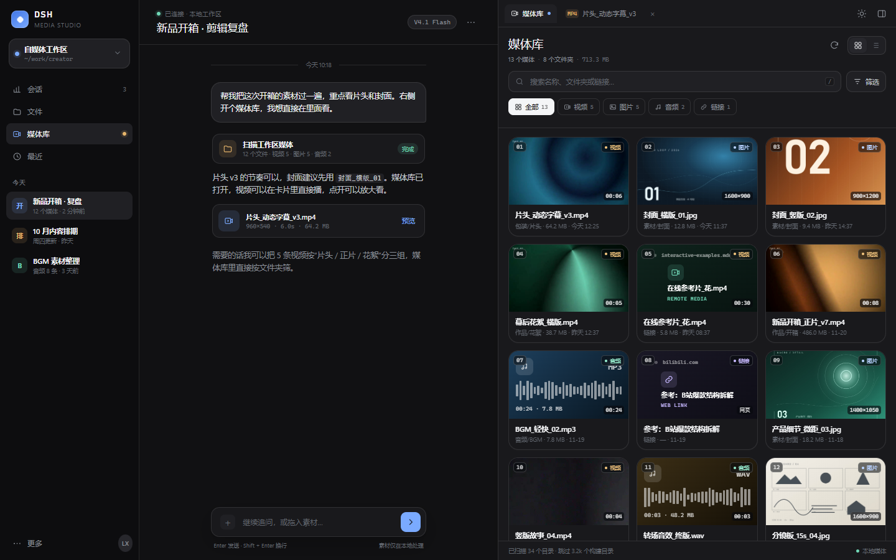
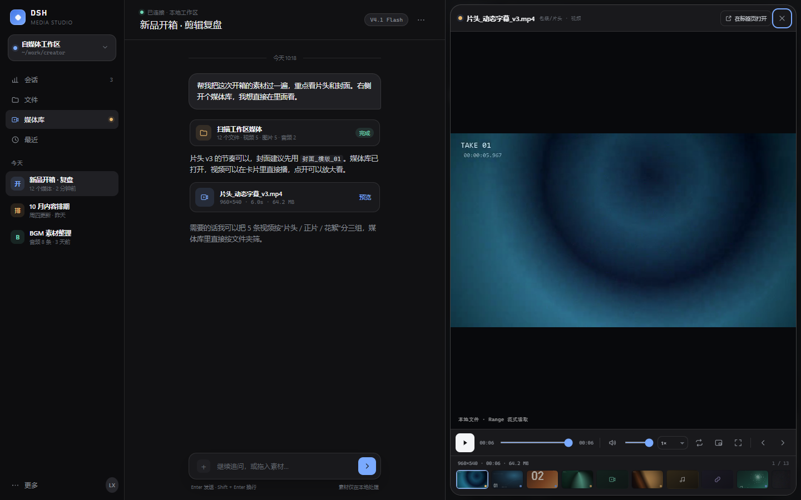

# dsh-vyra-file-manager 前端原型

纯 HTML / CSS / JavaScript，无构建步骤，直接打开 `index.html` 即可。

## 运行

```sh
# 任选一种
python -m http.server 4173
# 或
npx serve .
```

然后访问 `http://127.0.0.1:4173/`。

> 不建议直接双击 `index.html` 用 `file://` 打开：部分浏览器会限制本地音视频的加载。用上面的静态服务器最稳。

## 截图





## 已实现

- 右侧栏媒体库 tab，网格 / 列表两种视图
- 多条件筛选：名称（空格分词）、类型、文件夹、时间、大小；按名称/时间/大小/类型排序，升降序
- 视频卡片内原地播放；同一时间只播放一个
- 点击卡片打开面板内 overlay：视频/音频/图片/网页链接
- 视频/音频自定义控制条：播放、进度、音量、倍速、循环、画中画、全屏、上一个/下一个
- 音频 overlay：封面 + 波形动画
- 图片 overlay：滚轮缩放、拖动平移、适应窗口、1:1、双击缩放
- 网页链接 overlay：打开浏览器、复制链接
- 底部胶片条与键盘快捷键（`Esc` / `Space` / `←` / `→` / `F` / `M` / `L`）
- 深色 / 浅色主题、专注模式、扫描状态、toast
- 文件树/资源 tab 的视觉占位：“在标签页打开”会把当前素材切换成独立预览 tab

## 演示数据

- 视频/音频由 ffmpeg 生成，图片是设计好的 SVG 海报再栅格化为 JPG
- 在线视频使用 MDN 的 CC0 示例 `flower.mp4`，需要联网
- 原型用预提取的视频海报帧模拟 P0 的浏览器首帧缩略图，避免首屏抖动；正式实现按设计文档的 `IntersectionObserver` + 首帧方案

> 正式插件已把原型里的自绘播放器/灯箱替换为 `yet-another-react-lightbox` + 浏览器原生 `<video>/<audio controls>`；原型保留作为视觉参考。

## 与正式实现的差异

- 没有真实扫描本地工作区，数据是内置的 13 条样例
- “在标签页打开”只更新视觉 tab，不创建 DSH 资源 tab
- 没有调用 Host 的 `/api/vyra-media/file` 与 `/api/vyra-media/list`
- 没有拖入本地文件（P1）

设计细节见 [`../docs/设计文档.md`](../docs/设计文档.md)。
